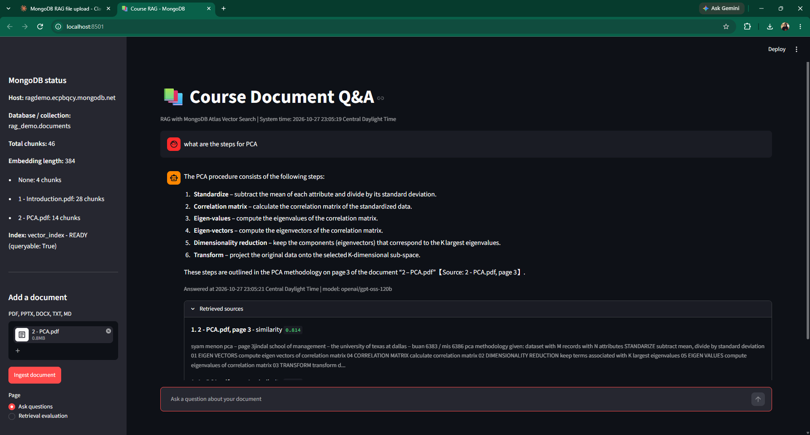

# Course Document Q&A — Retrieval-Augmented Generation with MongoDB

A Python project that lets a user upload course documents, retrieve relevant text chunks with MongoDB Atlas Vector Search, and ask questions grounded in the retrieved material. The app includes a Streamlit interface, source snippets with similarity scores, timestamps, and a small retrieval-evaluation workflow.

> **Project note:** This repository documents an academic project. The reported evaluation results below are from a small test set and should not be interpreted as a broad benchmark.

## Interface preview



The interface includes:
- MongoDB connection and collection status in the sidebar
- Upload and ingestion for PDF, PPTX, DOCX, TXT, and Markdown files
- A chat-style question-answering page
- Retrieved source text and similarity scores for transparency
- A retrieval-evaluation page with Hit@k and Mean Reciprocal Rank (MRR)

## What the project does

1. **Connects to MongoDB.** The app checks the database connection and reports the configured database, collection, document chunks, embedding dimensions, and available search-index status without printing the full connection URI.
2. **Extracts and chunks documents.** Supported files are converted to text and split into overlapping chunks (800 characters, with 150 characters of overlap by default). PDF pages and PowerPoint slides retain page/slide numbers where available.
3. **Creates embeddings.** Each chunk is embedded with `sentence-transformers/all-MiniLM-L6-v2`, with normalized embeddings.
4. **Stores chunks and vectors.** Chunk text, source filename, page number when available, chunk index, ingestion timestamp, and embedding are saved in MongoDB.
5. **Retrieves relevant context.** A question is embedded and relevant chunks are retrieved through MongoDB Atlas Vector Search.
6. **Generates a grounded answer.** When a Groq API key is configured, the app uses an OpenAI-compatible client pointed at Groq to generate an answer from the retrieved context. Retrieved source snippets and similarity scores are displayed with the answer.
7. **Evaluates retrieval.** A JSON question set can be used to measure Hit@1, Hit@3, Hit@5, and MRR, and to inspect top results for unsupported questions.

## Workflow, step by step

### 1. Configure services

- Set up a MongoDB deployment with Atlas Vector Search enabled.
- Create a database user and configure network access for the machine running the app.
- Create a vector search index on the collection used by the app. The default database is `rag_demo`, collection is `documents`, and index name is `vector_index`.
- Obtain a Groq API key if you want generated answers rather than retrieval-only output.

### 2. Set environment variables

Create a local `.env` file in the project directory (do **not** commit it):

```dotenv
MONGODB_URI=mongodb+srv://<username>:<password>@<cluster-host>/
MONGODB_DB=rag_demo
MONGODB_COLLECTION=documents
VECTOR_INDEX_NAME=vector_index
GROQ_API_KEY=<your-groq-api-key>
# Optional:
# LLM_BASE_URL=https://api.groq.com/openai/v1
# CHAT_MODEL=llama-3.3-70b-versatile
# MIN_SCORE=0.0
```

Replace placeholders locally. Never put real credentials in this README, screenshots, commits, or issue comments.

### 3. Install dependencies

Use Python 3.10+ in a virtual environment. Install the packages used by the app and the optional document readers:

```bash
python -m venv .venv
# Windows PowerShell:
.venv\Scripts\Activate.ps1
# macOS/Linux:
# source .venv/bin/activate

pip install streamlit pymongo python-dotenv openai sentence-transformers pypdf python-pptx python-docx
```

The sentence-transformers model is downloaded the first time it is loaded, so the first run can take longer.

### 4. Launch the Streamlit app

```bash
python -m streamlit run app.py
```

Open the local address printed in the terminal. Check the MongoDB status in the sidebar and confirm the Atlas vector index is active/queryable.

### 5. Ingest a document

1. Use **Add a document** in the sidebar.
2. Upload a PDF, PowerPoint, Word document, TXT, or Markdown file.
3. Select **Ingest document**.
4. Wait for extraction, chunking, embedding, and storage to finish.
5. Check the chunk count and source filename in the MongoDB status panel.

Re-ingesting a file with the same filename replaces its previous chunks for that filename.

### 6. Ask questions and inspect evidence

1. Choose **Ask questions** in the sidebar.
2. Ask a question whose answer is stated in the uploaded material.
3. Read the answer and expand **Retrieved sources**.
4. Check the source filename/page where available and the similarity scores. These are useful for checking whether the answer is supported by the indexed text.
5. Try a question that is not answered by the document and inspect whether the output appropriately signals the lack of supporting evidence. Retrieval scores alone do not guarantee that an answer is supported.

### 7. Evaluate retrieval

The app supports evaluation through a JSON question set. Each question should identify the expected relevant source/chunk using the format expected by `run_evaluation` in `app.py`.

- In the UI, choose **Retrieval evaluation** and upload a questions JSON file (or provide the configured default evaluation file in the project folder).
- Run the evaluation and review Hit@1, Hit@3, Hit@5, MRR, per-question ranks, top-1 scores, and top-1 sources.
- Include both supported and unsupported questions when testing, and interpret unsupported-question scores cautiously.

The accompanying coursework evidence recorded Hit@1 = 1.00, Hit@3 = 1.00, Hit@5 = 1.00, and MRR = 1.00 for **three supported questions**. Two unsupported questions were also inspected. This is a very small sample, so these figures demonstrate the test run rather than general retrieval quality.

## Command-line options

The same file also supports command-line workflows:

```bash
python app.py --status
python app.py --ingest path/to/document.pdf
python app.py --ask "What does the document say about refunds?"
python app.py --eval path/to/questions.json
python app.py --seed       # optional sample policy documents
```

`python app.py` starts an interactive question loop. Use `--reset` only if you intend to delete the collection's stored documents/chunks.

## Tech stack

- **Python** — application logic and document processing
- **Streamlit** — interactive web UI
- **MongoDB Atlas Vector Search / PyMongo** — vector retrieval and persistence
- **Sentence Transformers** — local text embeddings (`all-MiniLM-L6-v2`)
- **Groq API via an OpenAI-compatible client** — answer generation when configured
- **pypdf, python-pptx, python-docx** — document text extraction

## Repository contents

```text
.
├── app.py
├── README.md
└── assets/
    └── course-document-qa.png
```

## Security and limitations

- Keep `.env` and real credentials out of Git. Rotate any key that is accidentally committed.
- Do not upload private, confidential, or copyrighted course material to a public repository.
- The screenshot is an example of the interface, not a promise that an external database or API is available to other users.
- Results depend on document quality, chunking, embedding relevance, index configuration, model behavior, and the chosen evaluation questions.
- Scanned/image-only PDFs may require OCR before text can be extracted.

## Author

**Eman Furrukh** — Advanced Database course project.
